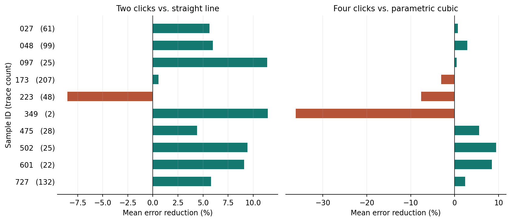

# CT-guided traces between papyrus annotation clicks

Given a grayscale cross-section through a Herculaneum scroll and two or more marked points on one sheet, this CPU tool traces between the clicks using the local CT texture. It returns either subpixel coordinates or a one-pixel-wide TIFF mask for annotator review. It needs no model weights. The application is sparse annotation of the recto surface, one slice at a time. [Vesuvius Challenge open problem](https://scrollprize.org/2026_open_problems).

## Run it

Use Python 3.11 or later. The TIFF/NumPy workflow requires NumPy, SciPy and Pillow. The optional multiscale input reader uses Zarr.

```sh
python -m pip install -r requirements.txt
python demo.py synthetic-example
python trace_slice.py synthetic-example/slice.tif synthetic-example/clicks.csv synthetic-example/trace.tif
python anchor_trace.py synthetic-example/slice.tif synthetic-example/clicks.csv synthetic-example/trace.csv
python -m unittest -v test_trace
```

Supply one anchor per line as `x,y`, measured from the top-left pixel center, in order along the same sheet. For a grayscale multipage TIFF, pass `--z 32` to select plane 32 (zero-based). For a local ZYX Zarr array or OME-Zarr group, install `zarr` and give the directory as the input. `--level 0` selects array key `0` within a group. Coordinates and the slice index are in that level's pixels. The TIFF output is a new 2D mask with background 0 and trace 1. Reuse it as an editable annotation on that plane. A new output filename is required.

## Evidence on real scroll CT

The public [Vesuvius Challenge surface dataset](https://huggingface.co/buckets/scrollprize/datasets/tree/surfaces/kaggle) pairs CT volumes with voxelized recto labels. The benchmark reveals sparse clicks to the method and withholds the traced pixels between them. Lower mean absolute error is better. With two clicks the geometric comparator is the straight chord. With four clicks it is a natural parametric cubic spline through the same four points. Each retained path receives equal weight.

| Evaluation set | Traces | Two clicks, chord → CT (px) | Four clicks, spline → CT (px) |
|---|---:|---:|---:|
| First four held-out volumes | 392 | 0.596 → 0.571 | 0.497 → 0.492 |
| Six further held-out volumes | 257 | 1.167 → 1.101 | 0.816 → 0.799 |
| All ten volumes | 649 | **0.822 → 0.781** | **0.624 → 0.613** |

With two clicks, the mean error decreased in 9 of 10 volumes and on 378 of 649 individual paths. For volume 00223 it increased from 0.399 to 0.433 pixels. Four-click interpolation improved in 7 of 10 volumes and on 344 of 649 paths. Averaged over all volumes, the 32-, 48- and 64-pixel gaps produced two-click errors of 0.569, 0.781 and 1.022 pixels, against 0.589, 0.824 and 1.086 for the chord.

The method and its constants were frozen after development on a separate volume (00001). Both held-out cohorts used identical code. In an exploratory two-click sensitivity check, increasing the optical correction weight from 0.20 to 0.50 gave errors of 0.609 and 1.041 pixels in the first and second held-out cohorts, respectively. The released code uses the original 0.20 weight.



## Method and scope

The initial path is a natural spline parameterized by arclength between the clicks. On a narrow strip following it, the program compares intensity profiles perpendicular to the chord at nearby positions. Normalized correlations in both directions estimate how far the same CT structure moved. Inconsistent matches are downweighted. Integrating those relative shifts gives an offset from the initial path. The endpoints are fixed, and the correction is damped to reduce jumps onto adjacent structures. This estimates local sheet direction without assuming that a surface annotation sits at the brightest point of a fiber.

The test cases contain coherent, horizontally traceable recto lines. Errors measure deviation in the image's y coordinate at corresponding x positions. Reference masks are voxelized, and different paths within one volume can be correlated. These measurements do not establish the speed of human annotation, the accuracy of ink reading, or performance on branches, sheet crossings, or arbitrary orientations. Inspect the resulting trace before accepting it. Extra anchor clicks are especially helpful at turns or between tightly packed layers.

## Reproduce the benchmark

Sample IDs for the first held-out cohort are 27, 48, 173 and 502. The six fresh IDs are 97, 223, 349, 475, 601 and 727. The code enumerates labeled segments at five fixed depth fractions and three horizontal windows, restricts ambiguous or branching traces, then scores every qualifying case with 32-, 48- or 64-pixel horizontal click spacing. Pixels adjacent to the scored anchors are excluded.

```sh
python fetch_ct.py --data data 1 27 48 173 502 97 223 349 475 601 727
(cd data && sha256sum -c ../SHA256SUMS)
python benchmark.py --data data --tracer anchor_trace.py --two --out two.csv 27 48 173 502 97 223 349 475 601 727
python benchmark.py --data data --tracer anchor_trace.py --out four.csv 27 48 173 502 97 223 349 475 601 727
```

To inspect a regression, a typical case and an improvement on raw scrolls, install `matplotlib` and run `python plot_examples.py --data data --tracer anchor_trace.py --scores case_errors.csv --output local-examples.png`. Cases are selected at the 10th, 50th and 90th percentiles of improvement in the six-volume replication set. See [per-trace errors](case_errors.csv) and [per-volume and click-spacing results](summary.csv). The repository distributes code and error summaries. Original scans and annotations are obtained directly from the organizer under the [Vesuvius data terms](https://dl.ash2txt.org/LICENSE.txt).

## Credits

This experiment and its code were developed with OpenAI Codex. Vesuvius Challenge supplied the public paired CT and surface labels. See also Parsons et al., [EduceLab-Scrolls: Verifiable Recovery of Text from Herculaneum Papyri using X-ray CT](https://doi.org/10.48550/arXiv.2304.02084). Code is distributed under the MIT License.
